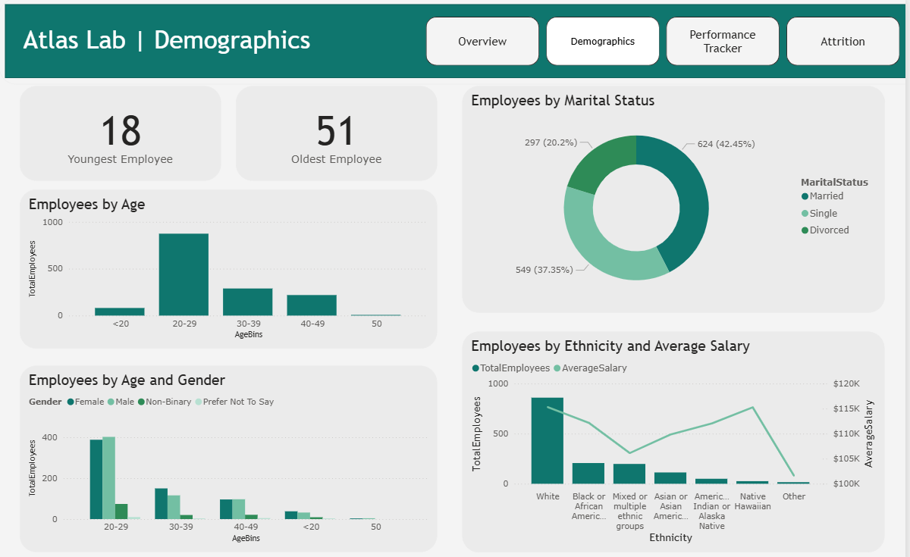

# HR Analytics in Power BI

An interactive Power BI case study that explores workforce demographics, employee performance, hiring trends, and attrition at Atlas Labs.

## Project overview

This report helps HR stakeholders monitor key workforce metrics, identify attrition patterns, understand workforce diversity, and review an individual employee's performance history.

## Dashboard pages

### Overview

High-level workforce KPIs, hiring trends, and department/job-role distribution.


### Demographics

Employee age, gender, marital status, ethnicity, and average salary analysis.



### Performance Tracker

An employee-level view with a searchable employee selector, last and next review dates, satisfaction scores, and self-versus-manager performance ratings over time.


### Attrition

Attrition analysis by department, job role, hiring cohort, business travel, overtime requirement, and tenure.


## Data model

The report follows a star/snowflake-style model built from one fact table and supporting dimensions.

| Table | Type | Purpose |
|---|---|---|
| `FactPerformanceRating` | Fact | Employee review events, ratings, satisfaction, and training data. |
| `DimEmployee` | Dimension | Employee profile, employment, demographic, and attrition information. |
| `DimDate` | Dimension | Shared date table for review and hiring-date analysis. |
| `DimEducationLevel` | Dimension | Education-level descriptions. |
| `DimRatingLevel` | Dimension | Self and manager performance-rating descriptions. |
| `DimSatisfiedLevel` | Dimension | Satisfaction-level descriptions. |


## Key metrics

- Total Employees
- Active Employees
- Inactive Employees
- Attrition Rate
- Attrition Rate by Hire Date
- Average Salary
- Last Review Date
- Next Review Date
- Self Rating and Manager Rating
- Environment, Job, Relationship, and Work-Life Satisfaction

## Key DAX patterns used

- `CALCULATE()` for filtered calculations.
- `DISTINCTCOUNT()` to count unique employees.
- `DIVIDE()` for safe percentage calculations.
- `USERELATIONSHIP()` to activate inactive date, rating, and satisfaction relationships within measures.
- `FORMAT()` to present employee review dates clearly.

## Key insights enabled

- Monitor overall workforce size and employee attrition.
- Compare attrition across departments, job roles, travel frequency, overtime requirements, and tenure.
- Identify hiring trends by year and assess attrition within hiring cohorts.
- Explore workforce demographics and salary patterns.
- Track an individual employee's review history, satisfaction, and performance ratings.

## Tools used

- Power BI Desktop
- Power Query
- DAX

## Repository contents

```text
.
├── dashboard/
│   └── Analyze HR dataset case study.pbix
├── dataset/
│   ├── DimDate.txt
│   ├── EducationLevel.csv
│   ├── Employee.csv
│   ├── PerformanceRating.csv
│   ├── RatingLevel.csv
│   └── SatisfiedLevel.csv
├── images/
│   ├── Attrition page.png
│   ├── Data Model.png
│   ├── Demographics.png
│   ├── Overview page.png
│   └── Performance Tracker page.png
└── README.md
```

## How to use

1. Download or clone this repository.
2. Open the `.pbix` file in Power BI Desktop.
3. Use the report filters and slicers to explore the data interactively.

